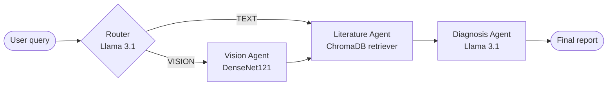

# 🩺 Radiology RAG — Multi-Agent Radiology Assistant

A local, privacy-friendly prototype that combines **chest X-ray image analysis** with **retrieval-augmented generation (RAG)** over radiology text, orchestrated as a multi-agent workflow with **LangGraph** and served through a **Streamlit** chat UI.

Everything runs on your machine: the LLM (Llama 3.1 via Ollama), the embedding model, the vector store (ChromaDB), and the vision model (PyTorch DenseNet121).

> ⚠️ **Research / educational prototype — not for clinical use.** See [Limitations](#-limitations) before reading anything into the outputs.

---

## ✨ Features

- **Dynamic agent routing** — an LLM router decides whether a query needs image analysis or can go straight to literature retrieval.
- **Vision agent** — a DenseNet121 wrapped as a LangChain `@tool` that reports findings across the 14 CheXNet thoracic disease labels.
- **Literature agent** — semantic search over a local ChromaDB of radiology reports.
- **Diagnosis agent** — synthesizes the query, image findings, and retrieved context into a final answer / differential diagnosis.
- **Hybrid retrieval experiment** — BM25 + dense retrieval fused with an ensemble, then re-ranked with a cross-encoder.
- **Streamlit UI** — upload an X-ray and chat with the system.

---

## 🏗️ Architecture

The production path (`app.py` → `dynamic_agent.py`) is a LangGraph `StateGraph` sharing a `ClinicalState`:



```python
class ClinicalState(TypedDict):
    patient_query: str
    image_path: str
    vision_findings: str
    literature_context: str
    final_report: str
```

The literature agent searches with the vision findings when present, otherwise with the original query.

For a beginner-friendly walkthrough of Agents, LangChain, and LangGraph as used here, see [`PROJECT_EXPLANATION.md`](PROJECT_EXPLANATION.md).

---

## 🧰 Tech Stack

| Layer | Technology |
|---|---|
| LLM | [Ollama](https://ollama.com) · `llama3.1` (temperature 0) |
| Orchestration | LangGraph, LangChain (LCEL) |
| Embeddings | `sentence-transformers/all-MiniLM-L6-v2` (CPU) |
| Vector store | ChromaDB (`langchain-chroma`) |
| Re-ranker | `BAAI/bge-reranker-base` cross-encoder + BM25 (`rank-bm25`) |
| Vision | PyTorch / torchvision DenseNet121 |
| UI | Streamlit |
| Packaging | [uv](https://docs.astral.sh/uv/), Python 3.12 |

---

## 🚀 Getting Started

### Prerequisites

- Python **3.12+**
- [uv](https://docs.astral.sh/uv/getting-started/installation/)
- [Ollama](https://ollama.com/download) running locally
- Optional: a CUDA GPU (the vision model uses it automatically if available)

### 1. Install dependencies

```bash
git clone <repo-url> radiology-rag
cd radiology-rag
uv sync
```

### 2. Pull the LLM

```bash
ollama pull llama3.1
```

Make sure the Ollama server is running (`ollama serve`, or the desktop app).

### 3. Build the vector databases

Two Chroma stores are used:

| Directory | Built by | Contents | Used by |
|---|---|---|---|
| `clinical_db/` | `build_rag.py`, then `expand_db.py` | A handful of curated definitions + differential-diagnosis snippets | `rag_agent.py`, `orchestrator.py`, `multi_agent.py` |
| `mimic_clinical_db/` | `build_large_rag.py` | ~500 radiology transcriptions from [MTSamples](https://huggingface.co/datasets/harishnair04/mtsamples), chunked at 500 chars | `dynamic_agent.py`, `app.py` |

```bash
uv run build_rag.py         # small curated DB
uv run expand_db.py         # add DDx documents to it
uv run build_large_rag.py   # larger report DB (downloads from Hugging Face)
```

> Despite its name, `mimic_clinical_db` currently holds MTSamples data. `build_large_rag.py` contains commented-out code to switch to MIMIC-CXR reports once you have PhysioNet credentials.

### 4. (Optional) Add sample X-rays

The demo scripts reference images from the [Indiana University Chest X-ray collection](https://openi.nlm.nih.gov/faq#collection) at:

```
data/images/
├── images_normalized/          # e.g. 1002_IM-0004-1001.dcm.png
├── indiana_projections.csv
└── indiana_reports.csv
```

`data/` is git-ignored — download the dataset (e.g. the Kaggle mirror *“Chest X-rays (Indiana University)”*) and place it there, or just upload any PNG/JPG through the UI.

### 5. Run the app

```bash
uv run streamlit run app.py
```

Open the URL Streamlit prints (default `http://localhost:8501`), optionally upload an X-ray in the sidebar, and ask a question, e.g.:

- *“Review this image and provide a DDx”*
- *“What defines a tension pneumothorax?”*

---

## 📁 Project Structure

```
radiology-rag/
├── app.py                 # Streamlit UI — invokes the dynamic LangGraph app
├── dynamic_agent.py       # LangGraph graph with LLM router (main pipeline)
├── multi_agent.py         # Earlier fixed pipeline: vision → literature → diagnosis
├── orchestrator.py        # Prebuilt ReAct agent (create_react_agent) with vision + RAG tools
├── rag_agent.py           # Minimal LCEL RAG chain demo
├── vision_tool.py         # DenseNet121 wrapped as the analyze_chest_xray tool
├── hybrid_retriever.py    # BM25 + dense ensemble + cross-encoder re-ranking demo
├── build_rag.py           # Builds clinical_db from mock abstracts
├── expand_db.py           # Adds differential-diagnosis docs to clinical_db
├── build_large_rag.py     # Builds mimic_clinical_db from MTSamples radiology reports
├── test_agent.py          # Ollama / Llama 3.1 smoke test
├── main.py                # Placeholder entry point
├── dummy_xray.png         # Sample input for multi_agent.py
├── PROJECT_EXPLANATION.md # Conceptual guide to the architecture
├── pyproject.toml / uv.lock
└── clinical_db/, mimic_clinical_db/, data/   # Local data (git-ignored)
```

---

## 🧪 Running the Individual Scripts

Each module is runnable on its own and doubles as a learning step:

```bash
uv run test_agent.py        # Is Ollama + llama3.1 working?
uv run vision_tool.py       # Run the vision tool on a sample image
uv run rag_agent.py         # Basic RAG chain against clinical_db
uv run hybrid_retriever.py  # Hybrid retrieval + re-ranking on mock docs
uv run orchestrator.py      # ReAct agent that picks its own tools
uv run multi_agent.py       # Fixed 3-agent LangGraph pipeline
uv run dynamic_agent.py     # Routed pipeline, image + text-only test cases
```

---

## ⚠️ Limitations

- **The vision model is not a trained chest X-ray classifier.** `vision_tool.py` loads DenseNet121 with generic **ImageNet** weights and maps the first 14 of its 1000 output logits onto the CheXNet disease labels. The reported “probabilities” are placeholders that demonstrate the tool-calling plumbing, not real findings. Swapping in real CheXNet / TorchXRayVision weights is the obvious next step.
- **Small knowledge base.** `clinical_db` holds only a few hand-written snippets; `mimic_clinical_db` holds ~500 MTSamples transcriptions. Answers are only as good as this context.
- **Routing is a single LLM call.** If the router picks `VISION` but no image was uploaded, the vision agent returns an error string, which is then passed downstream.
- **No evaluation, guardrails, or citation display** yet; retrieved sources are not shown in the UI.
- **Not a medical device.** Do not use for diagnosis or patient care.

---

## 🗺️ Roadmap

- [ ] Replace placeholder vision weights with a real CheXNet / TorchXRayVision model
- [ ] Ingest MIMIC-CXR reports (credentialed access)
- [ ] Use the hybrid retriever in the main `dynamic_agent.py` pipeline
- [ ] Show retrieved sources and vision findings in the Streamlit UI
- [ ] Add retrieval / answer-quality evaluation

---

## 🙏 Acknowledgements

- [CheXNet](https://stanfordmlgroup.github.io/projects/chexnet/) for the 14-label thoracic disease taxonomy
- [MTSamples](https://huggingface.co/datasets/harishnair04/mtsamples) transcription dataset
- Indiana University Chest X-ray collection (Open-i, NLM)
- LangChain, LangGraph, ChromaDB, Ollama, Hugging Face, and Streamlit
